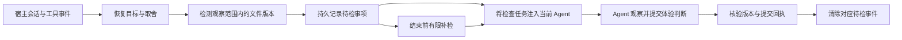

# Experience Strategy Harness

让设计 Agent 在工作过程中持续保留体验目标、历史取舍与验证状态，并在实际改动后进行检查。

**0.3.0-alpha.3 加入只读状态工作台。** 面板按项目与案件展示角色进度、交付依据、待检工作和用户效果状态。 做设计时，Critic 明确取舍，Execution 制作可检查的候选，Measurement 检查实际产物。用户效果单独保留为待验证。

从本版源码根目录运行 `python3 scripts/engine_demo.py --output /tmp/reading-create-01`（新目录）。打开输出的 `RESULTS.md` 查看原版、可操作候选与检查记录。[在实际项目分阶段接入](references/role-engine.md)

## 开始

```sh
git clone --branch v0.3.0-alpha.3 https://github.com/Goderbug/experience-strategy-harness.git
cd experience-strategy-harness
```

选择实际使用的宿主：

- **Codex**：[安装与信任 hooks](adapters/codex/README.md)。提供原生插件清单和项目级 hooks 安装器。
- **DeepSeek Harness / dsh**：[安装原生插件](adapters/deepseek/README.md)。接入原生 Agent 循环，复用宿主模型和工具，不另建 DeepSeek API 调用器。
- **其他 Agent / 只上传文档**：[START-HERE.md](START-HERE.md) 与 [EXPERIENCE-HARNESS.md](EXPERIENCE-HARNESS.md)。这是手动触发的可移植降级模式。

角色原型见 [v0.3.0-alpha.3 Release](https://github.com/Goderbug/experience-strategy-harness/releases/tag/v0.3.0-alpha.3)，上一版执行层见 [v0.2.0 Release](https://github.com/Goderbug/experience-strategy-harness/releases/tag/v0.2.0)。Python 核心只依赖标准库，要求 Python 3.9+；DSH 插件的宿主版本要求见适配器文档。

## 打开状态工作台

在解包的源码根目录运行以下命令，把 `--root` 指向要观察的项目根目录。刚跑完上面的演示时，可以直接指定 `/tmp/reading-create-01`。

```sh
python3 scripts/status_ui.py --root /path/to/project
```

打开终端打印的本机地址，也可以加 `--open` 让系统浏览器打开页面。默认使用可用端口，需要固定地址可加 `--port 8765`。重复传入 `--root` 可以在同一窗口切换项目。服务运行且页面打开时，页面定期读取项目保存的记录。按 Ctrl+C 结束服务。

在项目内选一个案件，查看当前阶段、哪项职责待接手，以及已经提交的产物与依据。常规刷新读取已保存的状态，点击「刷新并核对」会重查监测范围内的文件，并复核创作案件最近交付的候选和检查记录。用户效果取自项目判断；页面的刷新时间只表示本次读取时间。

要离线交接，指定一个新的 HTML 文件：

```sh
python3 scripts/status_ui.py --root /path/to/project --export /tmp/harness-status-01.html
```

导出时会执行同一次文件核对。双击 HTML 即可查看该时点的状态。快照包含所选项目的路径、主张、交付与证据引用，可在分享前核对内容。

## 执行层如何工作



| 环节 | 本版行为 |
|---|---|
| 会话开始 / 恢复 | 读回目标、未决问题和最近取舍；保留上次遗漏 |
| 本轮任务开始 | 注入体验关注，登记本轮影响判断 |
| 工具执行前 | 带入当前约束；这是提示，不是写入前强制审批 |
| 工具执行后 / 结束前 | 对配置范围做内容快照，识别新增、修改、删除 |
| 结束前仍有待检 | 默认最多续跑一次；不会无限自我审查 |
| 判断提交 | 检查对应事件、内容快照和状态版本后确认，旧回执不能清掉新变化 |
| 中断 / 失败 | 保留待检；下次恢复，不将中断写成通过 |

适配器负责**何时介入及是否留下记录**，宿主 Agent 负责**观察、分析、策略与验证**。验证器能检查结构和版本，不能证明判断质量或证据真实性。通过 `depth: none` 可以有理由地跳过无关变化，避免每次改动都生成建议。

## 启用一个项目

先在现有目标项目建立体验目标，再明确文件观察范围：

```sh
python3 scripts/harness.py init --root /path/to/project \
  --project-id pilot-01 --goal '让用户可靠完成核心任务' \
  --scope '当前授权的旅程与页面' --version baseline --mode analysis-only
python3 scripts/runtime.py setup --root /path/to/project \
  --watch 'src/**' --watch 'public/**' --max-continuations 1
python3 scripts/runtime.py context --root /path/to/project
```

将路径、目标和 watch 范围换成真实项目，再按对应宿主文档安装。运行时仅在明确 setup 的项目生效；安装插件本身不会对所有项目开启检查。真实反馈仍需要提供给 Agent；只读取文件快照无法知道用户遇到的全部体验问题。

## 状态与边界

- `.experience-strategy/state.json`：目标、问题、证据、取舍与检查历史。保留 v0.1 状态协议兼容性。
- `.experience-strategy/runtime.sqlite3`：执行状态、待检事件、续跑预算和确认回执。
- `scripts/runtime.py context`：查看执行状态与可提交的 checkpoint 模板。
- `.experience-strategy/engine.sqlite3`：显式开启 role case 时创建的案件、角色交付和回执。
- [运行协议](references/runtime-protocol.md)：触发、确认、恢复与观察范围。
- [分析状态协议](references/state-protocol.md)：证据类型、问题状态与持久化规则。

这里的“持续”是**宿主运行期间的事件驱动介入，加上跨会话恢复**。宿主退出后，策略执行在下一次会话恢复。单独运行的状态面板可继续读取已保存的记录。分析状态中的 `online:false` 保留其原义：未配置独立后台观察器，不能用它判断 hooks 是否安装成功。

## 验证和外测

[VALIDATION.md](VALIDATION.md) 分开记录核心合约、适配器测试、真实宿主接入测试和未完成的真实模型实验。工程测试通过不等于体验效果提升。

请按 [实验指南](references/experiment.md) 跑一个真实项目，回传 [RETURN-REPORT.md](templates/RETURN-REPORT.md)。重点比较：漏检是否减少、旧决定是否被保留、策略是否改变实际产物、增加了多少负担。独立事件清单仍然必要，不能用 harness 自己生成的记录充当完整覆盖分母。
