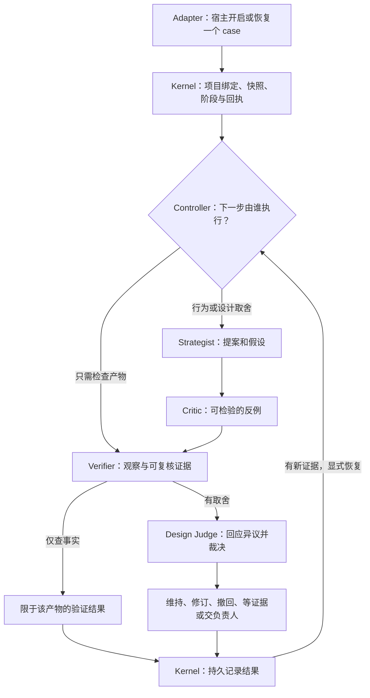

# 体验引擎：角色设置与逐层运行

这是一个供外部 Agent 试用的角色流程。先明确要判断的那一句话，再选择验证方式；“质量不错”无法作为可执行主张。例如“在当前阅读列表中，第一次使用的人能不经提示把文章留到稍后”是行为主张；“此宽度顶栏不再显示测试图标”是产物主张。

## 角色如何设置

在一个已启用 runtime 的项目中，宿主开启 case：给出项目体验目标、一个可被反驳的主张、主张类型、现场或模拟模式。如果决策还涉及方案取舍、已有反例或高返工成本，在 signals 中声明。已登记的问题可通过 concern_id 关联，冻结该问题、相关目标与取舍。该问题或相关目标后来变化会阻止继续提交；其他无关记录变化不影响本案。监测范围必须至少包含一个文件。项目工作目录与观察的产品范围必须一致；从另一个项目打开新 case 不会自动导入历史。

| 顺序 / 角色 | 收到什么 | 必须交回什么 | 权力边界 |
|---|---|---|---|
| 1 · Strategist 设计策略师 | 项目目标、冻结的主张、已有取舍 | 意图、备选、提案、关键假设、重开条件 | 提案不能自行批准。 |
| 2 · Critic 设计质评者 | 同一主张、策略师的方案 | 有实际用户后果的反例及检验方法；没有实质异议也说明原因 | 异议不能否决方案，更不能当成用户观察。 |
| 3 · Verifier 验证者 | 主张、需检验的分歧、项目实际可用工具和证据 | 执行方法、来源、适用范围、观察及不足、项目相对证据路径 | 可验证特定界面事实；缺少真人任务就不能确认用户行为。 |
| 4 · Design Judge 设计裁决者 | 同一版本的方案、异议和核验结果 | 维持 / 修订 / 撤回 / 暂缓 / 交负责人，回应异议、写清取舍和下次触发条件 | 裁决只在本案范围内生效。不授权改产品、发布、自动关闭原 concern，也不能把模拟写成产品成效。 |

角色是宿主可以承担的职责，不是四个一直运行的模型。出于成本考虑，单一宿主可以依次执行所有角色；历史中记录的是提交的职责，不能把这样的自审称作独立评审或多人共识。高风险价值取舍应交给实际负责人。

## 按层运行

| 层 | 职责 | 交接验收 |
|---|---|---|
| Adapter · 宿主入口 | 在已配置项目的 Codex / DSH 会话中找回案件；入口和宿主工具见适配器说明。 | 宿主能说明自己正处理哪个项目、哪个 case、哪个角色；不因新角色无限续跑。 |
| Kernel · 状态与证据 | 单独保存案件、项目绑定、文件版本、顺序、角色交付、幂等回执与证据文件指纹。 | 过期提交、越序角色、危险或失效证据不得推动阶段。 |
| Controller · 调度规则 | 简单产物断言交 Verifier；行为主张或有权衡、反证、高返工成本时走四角色链。证据不足可等待、续接。 | 同一初始提案因证据不同可走向维持、修订或等待；不自动替人判断业务价值。 |
| Capabilities · 实际工作 | 宿主按当前角色卡读材料、检查界面或收集已获授权的证据，把结构化输出交回 Kernel。 | 交付有范围、有依据。宿主没有数据时如实报告缺失；模型观点不替代真实参与者。 |



图中每一条角色间的交接均经过 Kernel 的版本和角色校验。

完整流转：宿主提出 case → Kernel 绑定版本 → Controller 返回下一角色卡 → 宿主执行并提交 → Kernel 校验并存档 → Controller 决定下一角色或停止。等待证据时下一角色为空；取得新证据后显式恢复到 Verifier，后续再裁决。交负责人表示需要产品取舍，不表示负责人已经批准。此版没有后台招募、遥测、发版或定时唤醒。

## 从零跑通

在仓库根目录，先试完全隔离的演示，不需要模型或 API key。output 必须是**尚不存在**的目录：

```sh
python3 scripts/engine_demo.py --output /tmp/reading-role-demo-01
python3 scripts/engine.py context --root /tmp/reading-role-demo-01 --case-id card-screen
```

读输出目录的 RESULTS.md 看结局、TRACE.json 看每一角色交付。三个行为分支共享相同主张；其中一条经历“只有静态证据 → 等待 → 取得模拟反例 → 复查”。另有单一 Verifier 的静态断言案例。模拟路径和真实项目使用同一个程序，不能混合解释证据。

## 用自己的项目

按 README 初始化项目和 watch 范围。保存以下 JSON 为 open.json（在 watch 范围外），从仓库运行：

```json
{"case_id":"reading-save","goal":"让读者保留稍后想读的文章，维持列表清晰","claim":"首次用户能无提示地完成稍后读","claim_type":"behavior","mode":"live","signals":["tradeoff"]}
```

```sh
python3 scripts/engine.py open --root /path/to/project --input open.json
python3 scripts/engine.py context --root /path/to/project --case-id reading-save
```

结果中的 next_role 和 brief 是本轮工作指令。宿主填好当前角色的 output，包装成 JSON 后调用：

```json
{"case_id":"reading-save","binding":"从该项目的 context 读取","expected_revision":0,"request_id":"为此次提交选用的唯一ID","role":"strategist","output":{"intent":"在列表中完成取舍","options":["维持当前入口","增加常驻入口"],"proposal":"维持当前入口","assumption":"首次用户能无提示完成稍后读","reopen_if":"用户已有保存意图却必须求助"}}
```

```sh
python3 scripts/engine.py submit --root /path/to/project --input submit.json
```

请把示例 revision 换成**刚读取的 revision**，binding 指示提交属于哪一个项目和案件，并非身份认证凭证。每次只执行返回的下一角色。静态 UI 检查要看运行产物，源码结论仅能指向源码；真人任务须使用获得授权的最小匿名证据。证据文件放项目内、观察范围外的独立目录；避免把整理观察笔记本身算作产品变更。冻结的产品版本变了时，重新复核，用新的 case 接替旧 case：在 open 输入中增加 supersedes（旧 case ID）并使用新 case_id。后继案件带回旧提案、裁决和重开条件作为历史；原来的证据不因此自动升级为当前版本的证据。

若进入 waiting_evidence：可以结束宿主，案件继续保留。等新的材料真的可用，再用 engine.py resume 提交 case_id、binding、expected_revision、request_id 和 reason。同一请求重试应使用相同 body；新工作用新 request_id。

## 两个相互独立的回执

角色提交只推进这个案子的设计判断；原 runtime 的 checkpoint 仍用于“本轮文件变化已检查”。二者都不会把体验问题自动改为 resolved。若希望判断进入项目策略账本，由宿主取得真实的待检 template，把本案引用、选择、限制与下一触发条件写入自己的策略 checkpoint。用户验收保持单独记录。

## 外测试什么

从一个有历史取舍的任务开始，中途切换会话。检查新宿主能否说出原假设、Critic 的异议、还缺哪种证据。再改变产品版本或替换证据文件，检查旧结果是否被拒绝。最后比较有无这套流程时，有多少决定实际被维持、修订或撤回，以及多花了多少工具调用和时间。每阶段产物齐全是工程证据；决定有没有变好，仍需独立核对。

适配范围：CLI 需 Python 3.9+；证据文件校验依赖 POSIX 的安全相对打开能力，Windows 未验证。本版可记录负责人待处理状态，外部审批仍由实际产品流程承担。
